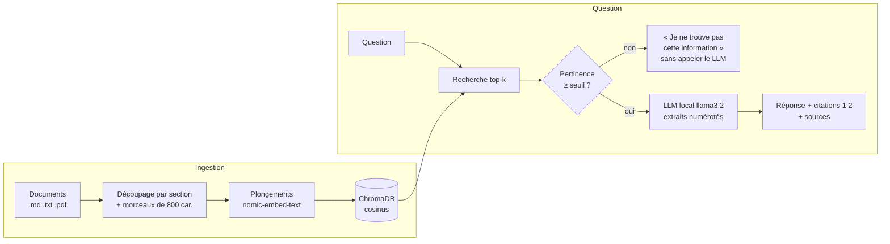

# Mes papiers — assistant privé pour vos documents personnels

Projet personnel. On signe tous des contrats qu'on ne relit jamais : bail, assurance habitation, forfait cellulaire, garanties, carte de crédit, abonnement au gym. Et le jour où on a une question (« mon assurance couvre-t-elle un dégât d'eau ? », « quel préavis pour annuler mon gym ? »), on ne retrouve plus la clause.

**Mes papiers** répond en français simple à ces questions, à partir de vos propres documents (Markdown, texte, PDF) :

- **Privé.** Le LLM open source tourne en local avec Ollama : vos documents personnels ne quittent jamais votre ordinateur.
- **Vérifiable.** Chaque réponse cite le document et la section d'où elle vient.
- **Honnête.** Si l'information n'est pas dans vos documents, l'assistant le dit au lieu d'inventer.
- **Mesuré.** Un script d'évaluation vérifie la qualité des réponses.

> Les documents de démonstration sont fictifs (locataire fictif « Alex Tremblay », entreprises inventées). L'assistant n'est pas un conseiller juridique : pour une décision importante, on vérifie auprès de l'organisme concerné.

## Fonctionnement



## Démarrage rapide (Mac)

```bash
# 1. Ollama : https://ollama.com/download, puis
ollama pull llama3.2
ollama pull nomic-embed-text

# 2. Projet
python3 -m venv .venv && source .venv/bin/activate
pip install -r requirements.txt
pytest -q                          # 10 tests, sans Ollama (faux modèles)

# 3. Utilisation
python -m rag_assistant ingest
python -m rag_assistant ask "Mon assurance couvre-t-elle un dégât d'eau ?"
python -m rag_assistant eval

# 4. API REST
uvicorn rag_assistant.api:app --reload    # puis http://localhost:8000/docs
```

Les réglages se changent par variables d'environnement : copier `.env.example` en `.env` et l'adapter (aucune clé d'API n'est nécessaire, tout tourne en local).

### Avec Docker

```bash
# Par défaut, l'API utilise l'Ollama de la machine hôte (accélération GPU Metal sur Mac)
docker compose up --build
curl -X POST localhost:8000/ingest
curl -X POST localhost:8000/ask -H "Content-Type: application/json" \
     -d '{"question": "Quel préavis dois-je donner pour annuler mon gym ?"}'

# Tout dans Docker, Ollama compris (CPU seulement sur Mac, plus lent)
OLLAMA_BASE_URL=http://ollama:11434 docker compose --profile ollama up --build
```

La base Chroma est conservée dans un volume Docker entre deux redémarrages.

### Exemple (sorties réelles)

```text
$ python -m rag_assistant ask "Mon assurance couvre-t-elle un dégât d'eau ?"

Oui, selon le contrat, les dégâts d'eau soudains et accidentels à l'intérieur du logement sont couverts [3].

  [3] assurance_habitation.md › Contrat d'assurance habitation — Locataire › Dégâts d'eau  (pertinence 0.69)

$ python -m rag_assistant ask "Qui a gagné la coupe Stanley en 1993 ?"

Je ne trouve pas cette information dans vos documents.

  470 ms · llama3.2 · mes-papiers-v1.0 · LLM non appelé
```

La seconde question n'atteint pas le seuil de pertinence : l'assistant refuse sans appeler le LLM.

## Choix techniques

- **Découpage par section.** Les fichiers Markdown sont d'abord coupés selon leurs titres. Chaque morceau garde le titre de sa section (« Contrat d'assurance habitation › Dégâts d'eau »), ce qui améliore la recherche et rend les citations lisibles. Les sections longues sont redécoupées en morceaux de 800 caractères, avec 120 caractères de chevauchement. Les PDF sont lus page par page.
- **Ingestion idempotente.** Chaque morceau a un identifiant stable, formé du nom du fichier, de l'empreinte de son contenu et du numéro du morceau. Un fichier inchangé n'est pas réindexé ; un fichier modifié remplace ses anciens morceaux ; un fichier supprimé est retiré de l'index. Relancer l'ingestion ne crée jamais de doublons.
- **Préfixes de tâche de nomic-embed-text.** Les morceaux sont vectorisés avec le préfixe `search_document:` et les questions avec `search_query:`, comme le prévoit le modèle (`PrefixedEmbeddings` dans `core.py`). Le texte stocké et cité reste intact. Changer de modèle ou de préfixes impose de réindexer : supprimer `chroma_db/` puis relancer `ingest`, car l'ingestion ne détecte que les changements de fichiers.
- **Garde-fou contre les hallucinations, en deux niveaux.**
  1. Si aucun morceau n'atteint le seuil de pertinence (`MIN_RELEVANCE`), l'assistant répond qu'il ne sait pas **sans appeler le LLM**. Avec nomic-embed-text et des documents en français, ce niveau n'arrête que les questions sans aucun rapport (voir « Réglages à calibrer »).
  2. Sinon, le prompt impose de n'utiliser que les extraits fournis, de citer `[n]` et de répondre une phrase précise quand l'information manque. C'est ce niveau qui refuse les questions hors documents plausibles (« Combien coûte mon assurance auto ? »).
- **Sources vérifiables.** Seules les sources réellement citées par le modèle sont renvoyées, avec leur score de pertinence.
- **Évaluation**, sur 17 questions de la vie courante, dont 3 hors documents (« quel est le solde de mon compte bancaire ? »). Quatre mesures, parce qu'un RAG peut échouer à plusieurs endroits :
  - recherche : le bon document est-il retrouvé ?
  - réponse : les éléments attendus (montants, dates, délais) sont-ils présents ?
  - réponse aux questions couvertes par les documents ;
  - refus des questions hors documents.

  Chaque rapport enregistre le modèle, la version du prompt, `top_k`, le seuil et la taille des morceaux, pour comparer deux réglages.
- **Tests sans Ollama.** Des plongements « sac de mots » déterministes et des faux LLM permettent de tester l'ingestion, les seuils, les refus et l'API dans la CI. Ces faux plongements ne reconnaissent que les mots identiques : « chat » ne retrouve pas « animaux ». C'est précisément ce que de vrais plongements sémantiques corrigent.

## Réglages à calibrer avec `eval`

Le seuil `MIN_RELEVANCE` dépend du modèle de plongements. Trop haut, l'assistant refuse des questions légitimes ; trop bas, il répond à des questions hors sujet. La bonne méthode : lancer `eval`, regarder le taux de bonnes réponses aux questions couvertes et le taux de refus des questions hors documents, ajuster, puis recommencer. Même démarche pour `TOP_K` et `CHUNK_SIZE`.

### Mesures du 25 novembre 2026

Configuration : nomic-embed-text, llama3.2, 6 documents, 32 morceaux. Pour chaque question, on regarde le score du meilleur morceau, sur les 17 questions d'`eval` plus 11 questions ajoutées pour l'occasion (3 couvertes, 8 hors documents).

| Meilleur score | sans préfixes | avec préfixes (retenu) |
|---|---|---|
| 17 questions couvertes | 0,656 à 0,793 | 0,634 à 0,765 |
| 11 questions hors documents | 0,612 à 0,716 | 0,588 à 0,723 |

- **Aucun seuil ne sépare les deux groupes.** Les scores sont tassés et se chevauchent : « Quel est mon numéro d'assurance sociale ? » (0,723) et « Quel est le solde de mon compte bancaire ? » (0,703) dépassent « Combien de temps le moteur de mon lave-vaisselle est-il garanti ? » (0,634). Les préfixes de tâche ne changent rien à ce constat ; nomic-embed-text est surtout entraîné sur de l'anglais. Un critère relatif, l'écart entre le meilleur morceau et la moyenne des autres, ne sépare pas mieux.
- **`MIN_RELEVANCE = 0.60` : un plancher, pas un filtre.** Il n'écarte aucune des questions couvertes mesurées (la plus basse : 0,634). Il arrête sans appeler le LLM les questions sans aucun rapport (« Qui a gagné la coupe Stanley en 1993 ? » : 0,588) et retire du contexte les morceaux les plus faibles. Les questions hors documents plausibles (assurance auto, solde bancaire, dentiste : 0,69 à 0,71) passent le seuil. **Le vrai garde-fou est la consigne du prompt**, qui les a toutes refusées.
- **`TOP_K = 4` conservé.** Pour les 14 questions couvertes d'`eval`, le bon document est déjà dans les 3 premiers morceaux. Monter `TOP_K` ajouterait du bruit pour un modèle de 3B sans corriger l'échec ci-dessous.

Résultats d'`eval` (chaque exécution écrit un rapport JSON détaillé dans `eval/results/`, non versionné) :

| Mesure | Avant : sans préfixes, seuil 0,45 | Après : préfixes, seuil 0,60 |
|---|---|---|
| Bon document retrouvé | 100 % | 100 % |
| Mots-clés attendus présents | 71 % | 86 % |
| A répondu aux questions couvertes | 93 % (13/14) | 93 % (13/14) |
| A refusé les questions hors documents | 100 % (3/3), par le prompt | 100 % (3/3), par le prompt |
| Latence médiane | 12,5 s | 11,2 s |

Sur 14 questions, un écart de deux bonnes réponses reste fragile. Les deux échecs restants :

- **« Mon assurance couvre-t-elle un refoulement d'égout ? »** Le morceau qui contient la réponse (« couverts jusqu'à 25 000 $ ») n'arrive qu'au 9ᵉ rang (7ᵉ sans préfixes), alors que le mot « refoulement » figure dans la question et dans le texte. Le LLM répond donc que l'information n'est pas précisée. C'est une erreur de **recherche**, invisible dans « bon document retrouvé » puisque cette mesure ne regarde que le fichier. Une recherche hybride (BM25) la corrigerait.
- **« Est-ce que j'ai le droit d'avoir un chat ? »** Le bon morceau arrive 3ᵉ. llama3.2 mélange la clause sur les chats et celle sur les chiens, puis ajoute la phrase de refus : la réponse est comptée comme un refus.

Pistes, à mesurer avec le même `eval` : recherche hybride, reclassement (reranking), modèle de plongements multilingue (par exemple `bge-m3`).

## Limites connues et prochaines étapes

- La recherche est uniquement vectorielle. Une recherche hybride (mots-clés BM25 + vecteurs) et un reclassement (reranking) aideraient pour les numéros exacts, les sigles et les termes précis (« refoulement d'égout », voir plus haut).
- La mesure « bon document retrouvé » regarde le fichier, pas le morceau : elle peut afficher 100 % alors que le passage qui contient la réponse n'a pas été retrouvé.
- Le jeu d'évaluation est petit et les mots-clés sont vérifiés littéralement. Un « LLM juge » permettrait d'évaluer la fidélité aux sources.
- Il n'y a pas d'historique de conversation : chaque question est traitée indépendamment.
- Les documents numérisés sans couche texte (photos de contrats) ne sont pas encore lus : il faudrait un OCR ou un modèle multimodal.
- Il n'y a pas encore d'interface web : la ligne de commande et l'API REST seulement.
- llama3.2 (3B) est rapide sur un portable mais limité en raisonnement. Le modèle se change avec `LLM_MODEL`.

## Structure

```
rag_assistant/
  config.py     Paramètres (modèles, découpage, top-k, seuil)
  prompts.py    Prompt versionné et réponse de refus
  loaders.py    Chargement .md/.txt/.pdf, découpage par section
  core.py       Indexer (ingestion idempotente) et Assistant (recherche + réponse)
  api.py        API FastAPI : /health, /ingest, /ask
  evaluate.py   Évaluation : recherche, réponse, refus, latence
  cli.py        Ligne de commande
data/docs/      Documents personnels de démonstration (fictifs)
eval/           Questions de référence et rapports
tests/          10 tests pytest (faux modèles)
```
