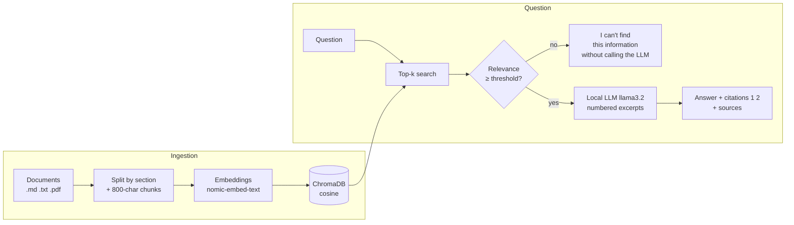

# Mes papiers — a private assistant for your personal documents

Personal project. We all sign contracts we never read again: lease, home insurance, phone plan, warranties, credit card terms, gym membership. And the day you have a question ("does my insurance cover water damage?", "how much notice do I need to cancel my gym?"), you can't find the clause anymore.

**Mes papiers** ("my papers") answers those questions in plain French, using your own documents (Markdown, text, PDF):

- **Private.** The open-source LLM runs locally with Ollama: your personal documents never leave your computer.
- **Verifiable.** Every answer cites the document and the section it comes from.
- **Honest.** If the information isn't in your documents, the assistant says so instead of making something up.
- **Measured.** An evaluation script checks the quality of the answers.

> The demo documents are fictional (fictional tenant "Alex Tremblay", made-up companies). The documents and the questions are in French, since the assistant targets French-speaking users in Quebec. This is not legal advice: for an important decision, check with the organization concerned.

## How it works



## Quick start (Mac)

```bash
# 1. Ollama: https://ollama.com/download, then
ollama pull llama3.2
ollama pull nomic-embed-text

# 2. Project
python3 -m venv .venv && source .venv/bin/activate
pip install -r requirements.txt
pytest -q                          # 10 tests, no Ollama needed (fake models)

# 3. Usage
python -m rag_assistant ingest
python -m rag_assistant ask "Mon assurance couvre-t-elle un dégât d'eau ?"
python -m rag_assistant eval

# 4. REST API
uvicorn rag_assistant.api:app --reload    # then http://localhost:8000/docs
```

Settings are environment variables: copy `.env.example` to `.env` and edit it (no API key needed, everything runs locally).

### With Docker

```bash
# By default, the API uses the host's Ollama (Metal GPU acceleration on Mac)
docker compose up --build
curl -X POST localhost:8000/ingest
curl -X POST localhost:8000/ask -H "Content-Type: application/json" \
     -d '{"question": "Quel préavis dois-je donner pour annuler mon gym ?"}'

# Everything in Docker, Ollama included (CPU only on Mac, slower)
OLLAMA_BASE_URL=http://ollama:11434 docker compose --profile ollama up --build
```

The Chroma database is kept in a Docker volume between restarts.

### Example (real output)

```text
$ python -m rag_assistant ask "Mon assurance couvre-t-elle un dégât d'eau ?"

Oui, selon le contrat, les dégâts d'eau soudains et accidentels à l'intérieur du logement sont couverts [3].

  [3] assurance_habitation.md › Contrat d'assurance habitation — Locataire › Dégâts d'eau  (pertinence 0.69)

$ python -m rag_assistant ask "Qui a gagné la coupe Stanley en 1993 ?"

Je ne trouve pas cette information dans vos documents.

  470 ms · llama3.2 · mes-papiers-v1.0 · LLM non appelé
```

The first question ("does my insurance cover water damage?") gets a sourced answer. The second one ("who won the Stanley Cup in 1993?") doesn't reach the relevance threshold, so the assistant refuses without calling the LLM.

## Technical choices

- **Splitting by section.** Markdown files are first split on their headings. Each chunk keeps its section title ("Contrat d'assurance habitation › Dégâts d'eau"), which helps retrieval and makes citations readable. Long sections are split again into 800-character chunks with a 120-character overlap. PDFs are read page by page.
- **Idempotent ingestion.** Each chunk has a stable ID made of the file name, a hash of its content and the chunk number. An unchanged file isn't re-indexed, a modified file replaces its old chunks, and a deleted file is removed from the index. Running ingestion again never creates duplicates.
- **nomic-embed-text task prefixes.** Chunks are embedded with the `search_document:` prefix and questions with `search_query:`, as the model expects (`PrefixedEmbeddings` in `core.py`). The stored and cited text stays untouched. Changing the model or the prefixes means re-indexing: delete `chroma_db/` and run `ingest` again, since ingestion only detects file changes.
- **Two-level guard against hallucinations.**
  1. If no chunk reaches the relevance threshold (`MIN_RELEVANCE`), the assistant says it doesn't know **without calling the LLM**. With nomic-embed-text and French documents, this level only stops completely unrelated questions (see "Tuning with `eval`").
  2. Otherwise, the prompt requires the model to use only the provided excerpts, cite `[n]`, and reply with a fixed sentence when the information is missing. This is the level that refuses plausible out-of-scope questions ("how much is my car insurance?").
- **Verifiable sources.** Only the sources the model actually cited are returned, with their relevance score.
- **Evaluation** on 17 everyday questions, 3 of them not covered by the documents ("what's my bank account balance?"). Four metrics, because a RAG system can fail in several places:
  - retrieval: is the right document found?
  - answer: are the expected details (amounts, dates, deadlines) present?
  - answering the questions the documents cover;
  - refusing the questions they don't.

  Each report records the model, prompt version, `top_k`, threshold and chunk size, so two settings can be compared.
- **Tests without Ollama.** Deterministic bag-of-words embeddings and fake LLMs make it possible to test ingestion, thresholds, refusals and the API in CI. These fake embeddings only match identical words: "chat" (cat) doesn't find "animaux" (pets). That's exactly what real semantic embeddings fix.

## Tuning with `eval`

The `MIN_RELEVANCE` threshold depends on the embedding model. Too high, and the assistant refuses legitimate questions; too low, and it answers off-topic ones. The method: run `eval`, look at the answer rate on covered questions and the refusal rate on out-of-scope ones, adjust, and repeat. Same approach for `TOP_K` and `CHUNK_SIZE`.

### Measurements from November 25, 2026

Setup: nomic-embed-text, llama3.2, 6 documents, 32 chunks. For each question I looked at the score of the best chunk, over the 17 `eval` questions plus 11 extra questions (3 covered, 8 out of scope).

| Best score | without prefixes | with prefixes (kept) |
|---|---|---|
| 17 covered questions | 0.656 to 0.793 | 0.634 to 0.765 |
| 11 out-of-scope questions | 0.612 to 0.716 | 0.588 to 0.723 |

- **No threshold separates the two groups.** Scores are compressed and overlap: "what's my social insurance number?" (0.723) and "what's my bank account balance?" (0.703) score higher than "how long is my dishwasher motor under warranty?" (0.634). Task prefixes don't change that; nomic-embed-text is mostly trained on English. A relative criterion (gap between the best chunk and the average of the others) doesn't separate them any better.
- **`MIN_RELEVANCE = 0.60`: a floor, not a filter.** It doesn't drop any of the measured covered questions (lowest: 0.634). It stops completely unrelated questions without calling the LLM ("who won the Stanley Cup in 1993?": 0.588) and removes the weakest chunks from the context. Plausible out-of-scope questions (car insurance, bank balance, dentist: 0.69 to 0.71) pass the threshold. **The real guard is the prompt**, which refused all of them.
- **`TOP_K = 4` kept.** For the 14 covered `eval` questions, the right document is already in the top 3 chunks. Raising `TOP_K` would add noise for a 3B model without fixing the failure below.

`eval` results (each run writes a detailed JSON report to `eval/results/`, not versioned):

| Metric | Before: no prefixes, threshold 0.45 | After: prefixes, threshold 0.60 |
|---|---|---|
| Right document found | 100% | 100% |
| Expected keywords present | 71% | 86% |
| Answered covered questions | 93% (13/14) | 93% (13/14) |
| Refused out-of-scope questions | 100% (3/3), by the prompt | 100% (3/3), by the prompt |
| Median latency | 12.5 s | 11.2 s |

With 14 questions, a gap of two correct answers is still fragile. The two remaining failures:

- **"Does my insurance cover a sewer backup?"** The chunk with the answer ("covered up to $25,000") only ranks 9th (7th without prefixes), even though the word "refoulement" (backup) appears in both the question and the text. So the LLM answers that the information isn't specified. It's a **retrieval** error, invisible in "right document found" since that metric only looks at the file. Hybrid search (BM25) would fix it.
- **"Am I allowed to have a cat?"** The right chunk ranks 3rd. llama3.2 mixes up the clause about cats and the one about dogs, then adds the refusal sentence, so the answer counts as a refusal.

Next ideas, to be measured with the same `eval`: hybrid search, reranking, a multilingual embedding model (e.g. `bge-m3`).

## Known limitations and next steps

- Retrieval is vector-only. Hybrid search (BM25 keywords + vectors) and reranking would help with exact numbers, acronyms and specific terms ("refoulement d'égout", see above).
- The "right document found" metric checks the file, not the chunk: it can show 100% even when the passage with the answer wasn't retrieved.
- The evaluation set is small and keywords are checked literally. An "LLM as a judge" could evaluate faithfulness to the sources.
- No conversation history: each question is handled on its own.
- Scanned documents without a text layer (photos of contracts) aren't read yet: that would need OCR or a multimodal model.
- No web interface yet: command line and REST API only.
- llama3.2 (3B) is fast on a laptop but limited at reasoning. The model can be changed with `LLM_MODEL`.

## Structure

```
rag_assistant/
  config.py     Settings (models, chunking, top-k, threshold)
  prompts.py    Versioned prompt and refusal answer
  loaders.py    Loads .md/.txt/.pdf, splits by section
  core.py       Indexer (idempotent ingestion) and Assistant (retrieval + answer)
  api.py        FastAPI API: /health, /ingest, /ask
  evaluate.py   Evaluation: retrieval, answer, refusal, latency
  cli.py        Command line
data/docs/      Personal demo documents (fictional, in French)
eval/           Reference questions and reports
tests/          10 pytest tests (fake models)
```
